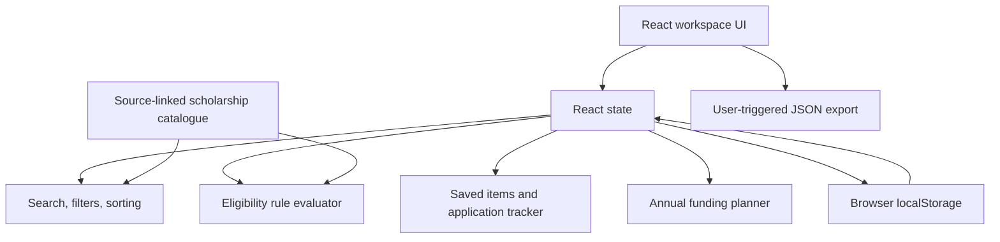

# Grantly — Architecture & Engineering Decisions

## Current system

Grantly is a client-side React single-page application. It intentionally does not require a server, database, identity provider or third-party API for the current user journey.

## Module responsibilities

| Module | Responsibility | Current boundary |
|---|---|---|
| `App.tsx` | Main shell, discover/saved/tracker/profile views, application state and dialogs | UI orchestration; no network persistence |
| `data.ts` | Typed scholarship catalogue, official-source metadata and criteria | Curated static data; not live/authoritative |
| `matching.ts` | Deterministic criteria evaluation | Only evaluates encoded rules; unknowns stay unknown |
| `FundingPlanner.tsx` | Annual cost/support inputs, gap calculation, local persistence and JSON export | User-entered values only; no financial data API |\n| `EssayWorkspace.tsx` | Guided personal statement outline, word count, local draft persistence and text export | No essay generation, plagiarism scoring or remote writing service |
| `styles.css` | Layout, visual tokens, responsive behavior and reduced-motion handling | CSS-based design system |
| `*.test.ts(x)` | Rule, component, workflow and accessibility regression tests | Tests do not replace browser/assistive-tech testing |

## Data flow

1. The catalogue provides each scholarship's metadata, official source, review note, and any encoded rules.
2. The student may fill optional profile fields in the local profile editor.
3. `matching.ts` evaluates each encoded rule independently.
4. The UI reports met / not-met / unknown results. A scheme without enough verified rules requires official review.
5. Students may save an opportunity or add it to the tracker; checklist and stage changes are stored locally.
6. The Funding Planner calculates cost, support, gap and coverage from the values the student enters.
7. Export actions create files in the user's browser. No profile or planner record is transmitted remotely.

## Eligibility model

The engine is a deterministic screening aid, not a legal, administrative or AI decision.

- `met`: the provided value satisfies the encoded rule.
- `not-met`: the provided value contradicts the encoded rule.
- `unknown`: the field is missing or cannot be interpreted safely.
- `Official review required`: a scheme has no complete, validated rule set encoded.

Unknown must never be converted into positive eligibility. The current rules do not cover every criterion of every scholarship. A provider's current notice takes precedence over this app.

## Funding calculation

For a single academic year:

- **Estimated cost** = tuition + housing + food + books + transport + other costs.
- **Entered support** = existing aid + hypothetical scholarship.
- **Estimated gap** = max(0, cost − support).
- **Coverage** = min(100%, support / cost); when cost is zero, coverage is 0%.
- **Surplus** = max(0, support − cost).

This is arithmetic based on user inputs. It does not verify whether grants can be stacked, whether aid displaces institutional funding, whether funds are taxable, or whether a college's cost estimate is complete.

## Persistence and privacy

- Workspace data is stored in localStorage in the current browser profile.
- Browser storage can be unavailable, cleared or modified by the user or scripts.
- localStorage is not encrypted, authenticated or a secure document vault.
- Current export is a user-triggered JSON file.
- No data is sent to a remote service by the current application. This includes profile, planner and essay draft data.

This is an appropriate boundary for a prototype, not for a multi-user production financial aid service.

## Security considerations

- React escapes interpolated text by default; do not add `dangerouslySetInnerHTML` for user-entered content.
- Validate imported or persisted data at the boundary; never assume localStorage is trustworthy.
- Keep official URLs HTTPS and use safe external-link attributes.
- Do not store secrets, credentials, bank details, government identity numbers or uploaded document contents.
- A production architecture would need a threat model, authenticated sessions, server-side authorization, input validation, secure document storage, encryption, audit trails, retention/deletion policies, monitoring, backups and incident response.

## Performance and accessibility

- Keep domain logic pure and independently testable where possible.
- Avoid making a performance claim without measurements from a production build and target browser.
- Controls must have accessible names and visible keyboard focus.
- Dialogs must support keyboard interaction and focus management.
- Reduced-motion preferences must be respected.
- Responsive behavior should be checked at narrow phone, tablet and desktop breakpoints.
- axe-core results are useful automated regression checks but do not establish formal WCAG conformance.

## Architectural evolution

The next modularization step is to extract scholarship discovery/filtering into a domain service, workspace persistence into a storage adapter, eligibility logic into a versioned rules module, exports into a dedicated service, and views into route-level components. Refactor when driven by testability and product needs, not to create an artificial enterprise architecture.
\n## Feature boundaries\n\n- `features/workspace/store.ts`: validates and hydrates browser-local saved IDs, application stages, document checklist values and profile fields. The local store is treated as untrusted input.\n- `features/scholarships/search.ts`: pure filtering and ranking across name, provider, category, region, description, tags, source notes and eligibility text.\n- `matching.ts`: pure rule-based eligibility screening with explicit unknown states.\n- `data.ts`: scholarship catalogue records and source/review metadata.\n\nThe application shell still coordinates the current page state. Further extraction into feature-specific components should follow user-facing testing and avoid introducing a complex state-management framework without a need.\n