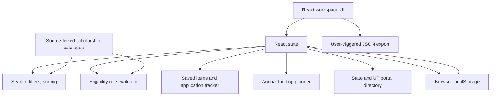

# Grantly — Architecture & Engineering Decisions

## Current system

Grantly is a client-side React single-page application. It intentionally does not require a server, database, identity provider or third-party API for the current user journey.

## Module responsibilities

| Module | Responsibility | Current boundary |
|---|---|---|
| `App.tsx` | Main shell, discover/saved/tracker/profile views, application state and dialogs | UI orchestration remains a refactoring target; no network persistence |
| `features/workspace/useWorkspace.ts` | Workspace state, local persistence and common tracker mutations | Browser-only state; no backend sync |
| `features/guide/portalDirectory.ts` | State / UT scholarship portal directory | Portal starting points, not an exhaustive scheme registry |
| `features/guide/StateScholarshipPortalDirectory.tsx` | Searchable state/UT portal directory UI | External official routes; current rules are provider-owned |
| `data.ts` | Typed scholarship catalogue, official-source metadata and criteria | Curated static data; not live/authoritative |
| `matching.ts` | Deterministic criteria evaluation | Only evaluates encoded rules; unknowns stay unknown |
| `FundingPlanner.tsx` | Annual cost/support inputs, gap calculation, local persistence and JSON export | User-entered values only; no financial data API |
| `EssayWorkspace.tsx` | Guided personal statement outline, word count, local draft persistence and text export | No essay generation, plagiarism scoring or remote writing service |
| `styles.css` | Layout, visual tokens, responsive behavior and reduced-motion handling | CSS-based design system |
| `*.test.ts(x)` | Rule, component, workflow and accessibility regression tests | Tests do not replace browser/assistive-tech testing |

## Catalogue composition

`data.ts` contains the core typed catalogue. `dataSupplement.ts` adds reviewed national, private, UGC and Karnataka programmes. `dataRegional.ts` adds state-level programme records whose official sources were reviewed on 7 November 2026. `catalog.ts` composes these lists and de-duplicates by stable ID. New records with incomplete or conditional rules must use an empty `rules` array and a clear manual-review note.

## Data flow

1. The catalogue provides each scholarship's metadata, official source, review note, and any encoded rules.
2. The student may fill optional profile fields in the local profile editor.
3. `matching.ts` evaluates each encoded rule independently.
4. The UI reports met / not-met / unknown results. A scheme without enough verified rules requires official review.
5. Students may save an opportunity or add it to the tracker; checklist and stage changes are stored locally.
6. The Funding Planner calculates cost, support, gap and coverage from the values the student enters.
7. Export actions create files in the user's browser. No profile or planner record is transmitted remotely.

## Eligibility model

The engine is a deterministic screening aid, not a legal, administrative or AI decision.

- `met`: the provided value satisfies the encoded rule.
- `not-met`: the provided value contradicts the encoded rule.
- `unknown`: the field is missing or cannot be interpreted safely.
- `Official review required`: a scheme has no complete, validated rule set encoded.

Unknown must never be converted into positive eligibility. The current rules do not cover every criterion of every scholarship. A provider's current notice takes precedence over this app.

## Funding calculation

For a single academic year:

- **Estimated cost** = tuition + housing + food + books + transport + other costs.
- **Entered support** = existing aid + hypothetical scholarship.
- **Estimated gap** = max(0, cost − support).
- **Coverage** = min(100%, support / cost); when cost is zero, coverage is 0%.
- **Surplus** = max(0, support − cost).

This is arithmetic based on user inputs. It does not verify whether grants can be stacked, whether aid displaces institutional funding, whether funds are taxable, or whether a college's cost estimate is complete.

## Offline delivery

- The production build registers a service worker.
- The service worker caches the application shell and same-origin static assets after an online visit.
- Navigation uses network-first with cached HTML fallback; same-origin static resources use cache-first.
- External government portal pages are not cached or proxied.
- Scholarship deadlines and provider information are not guaranteed to be current while offline.
- PWA installation and offline behavior must be verified on real browsers and devices before being advertised as a supported service-level guarantee.

## Persistence and privacy

- Workspace data is stored in localStorage in the current browser profile.
- Browser storage can be unavailable, cleared or modified by the user or scripts.
- localStorage is not encrypted, authenticated or a secure document vault.
- Current export is a user-triggered JSON file.
- No data is sent to a remote service by the current application. This includes profile, planner and essay draft data.

This is an appropriate boundary for a prototype, not for a multi-user production financial aid service.

## Security considerations

- React escapes interpolated text by default; do not add `dangerouslySetInnerHTML` for user-entered content.
- Validate imported or persisted data at the boundary; never assume localStorage is trustworthy.
- Keep official URLs HTTPS and use safe external-link attributes.
- Do not store secrets, credentials, bank details, government identity numbers or uploaded document contents.
- A production architecture would need a threat model, authenticated sessions, server-side authorization, input validation, secure document storage, encryption, audit trails, retention/deletion policies, monitoring, backups and incident response.

## Hosting and security

Vercel applies the configured CSP, HSTS, nosniff, frame protection, referrer policy, permissions policy and COOP headers. Hashed assets use immutable caching; the service-worker shell cache is versioned and must be bumped when the app shell changes. These headers are defense-in-depth for a static frontend, not backend security controls.

## Performance and accessibility

- Keep domain logic pure and independently testable where possible.
- Avoid making a performance claim without measurements from a production build and target browser.
- Controls must have accessible names and visible keyboard focus.
- Dialogs must support keyboard interaction and focus management.
- Reduced-motion preferences must be respected.
- Responsive behavior should be checked at narrow phone, tablet and desktop breakpoints.
- axe-core results are useful automated regression checks but do not establish formal WCAG conformance.

## Architectural evolution

The application shell coordinates the current page state. Workspace persistence and tracker mutations have been extracted into the useWorkspace hook; portal directory data and UI live under features/guide. Next refactor candidates include route-level views and a source/data validation service, based on measurable testability and bundle needs—not artificial architecture.

## Feature boundaries

- `features/workspace/store.ts`: validates and hydrates browser-local saved IDs, application stages, document checklist values and profile fields. The local store is treated as untrusted input.
- `features/scholarships/search.ts`: pure filtering and ranking across name, provider, category, region, description, tags, source notes and eligibility text.
- `matching.ts`: pure rule-based eligibility screening with explicit unknown states.
- `data.ts`: scholarship catalogue records and source/review metadata.

The application shell still coordinates the current page state. Further extraction into feature-specific components should follow user-facing testing and avoid introducing a complex state-management framework without a need.

## Workspace portability

The JSON backup includes the workspace state plus the local funding planner and essay draft. The import path:

1. Rejects files larger than 2 MB.
2. Requires the Grantly export envelope.
3. Validates scholarship IDs, tracker stages, document checklist values and profile strings.
4. Clamps numeric planner values and bounds essay fields / word-limit settings.
5. Writes validated values to browser storage only.

No imported profile, financial planner value or statement draft is sent to a server. Export files may contain personal information and should be handled as sensitive user-owned data.

## Runtime loading and feature boundaries

The application shell owns navigation, workspace composition, global notifications, and cross-feature coordination. Feature-specific behaviour is kept in focused modules under `src/features/` (scholarships, profile, guide, workspace, essay, and funding planner), while reusable UI is kept in feature component folders.

Secondary workspaces and overlays are loaded with React lazy imports and local Suspense boundaries:

- Funding planner and statement workspace are loaded only when their navigation destinations are opened.
- Student guide and profile page are loaded on demand.
- Scholarship detail and profile-edit dialogs are loaded only when opened.
- Each boundary exposes a semantic `role="status"` loading message, so deferred loading is announced to assistive technology and does not leave a blank region.

This keeps the initial discovery route from eagerly downloading every secondary workflow. The scholarship catalogue and discovery components remain in the initial route because they are required for the primary user journey. Build output should be inspected after each significant feature addition to ensure that code splitting continues to produce separate feature chunks and that no oversized shared chunk is introduced.

## Verification expectations

The CI workflow runs linting, TypeScript checks, unit/component tests, a production build, and an npm dependency audit. Before a release, also inspect the generated asset sizes, test keyboard-only navigation and dialog focus behaviour, and validate the deployed experience at narrow mobile, tablet, and desktop widths. A passing CI run is necessary but does not replace real-browser responsive, accessibility, and performance audits.
