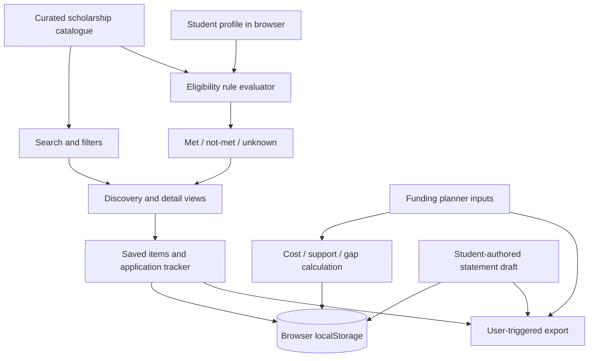

# GRANTLY — Rethinking the Scholarship Experience

**A modern, human-centred digital workspace for discovering, understanding, tracking and preparing educational funding applications.**

[](https://github.com/PSP-YN/Grantly/actions/workflows/ci.yml)
[](https://www.typescriptlang.org/)
[](https://oxc.rs/docs/guide/usage/linter.html)
[](https://vitest.dev/)
[](https://www.w3.org/TR/WCAG21/)
[](https://docs.npmjs.com/cli/commands/npm-audit)
[](LICENSE)

---

## Executive summary

Higher education can change a student's economic future, but finding and applying for financial assistance is often fragmented and difficult. Students may face:

- **Search fatigue:** information spread across national, state, institutional and private portals, with inconsistent terminology and changing application windows.
- **Eligibility uncertainty:** long criteria pages make it difficult to understand which requirements are satisfied, missing or need official confirmation.
- **Process paralysis:** saved links, documents, application stages and deadlines are easily scattered across notes and spreadsheets.
- **Writing friction:** applicants need a practical way to structure a personal statement while keeping it authentic to their own experience.
- **Financial ambiguity:** students may not have a clear estimate of annual education costs, existing support and the remaining funding gap.

**Grantly brings these preparation tasks into one student-controlled workspace.** It combines a curated, source-linked scholarship directory with transparent profile checks, a local application tracker, a document checklist, a funding-gap planner, a personal-statement workspace and a directory of official state and union-territory portals.

Grantly is designed to reduce friction and improve decision clarity. It does not make award decisions, submit applications to providers or guarantee eligibility.

## Product capabilities

| Experience | What is implemented |
|---|---|
| Scholarship discovery | Search, filter and sort a curated directory of source-linked scholarships, fellowships and assistance programmes. |
| Eligibility screening | Compare profile inputs with the subset of explicit rules encoded for each programme; show matched, mismatched and unknown checks. |
| Source transparency | Show provider/source links, review dates and notes about the limits of verification. |
| Application workspace | Save opportunities, track application stages and maintain per-opportunity document checklists. |
| Funding planner | Estimate annual costs, entered support, coverage, surplus and remaining gap using INR and user-provided values. |
| Funding intelligence | Model confirmed and proposed support, estimate an education-loan EMI, flag potential overfunding for provider review, manage the application pipeline and run local statement-clarity diagnostics. |
| Statement workspace | Structure a personal statement around motivation, experience, impact and goals; count words and export the student's own draft. |
| Workspace portability | Export and restore a validated local workspace backup, including supported planner and statement data. |
| Deadline calendar | Export calendar events for opportunities with explicit, dated deadlines. |
| State / UT portal directory | Find official scholarship portal starting points for all Indian states and union territories. |
| Installable web app | PWA manifest and service-worker caching support an installable app shell after an initial online visit. |

### What is deliberately not claimed

The current release is a **browser-first, client-side product**. It does not currently provide account authentication, server-side profiles, cloud synchronisation, live scholarship ingestion, automated deadline monitoring, a secure document vault, official application submission, institution integrations, AI essay generation, AI voice-authenticity scoring, loan amortisation, scholarship-displacement prediction or automated appeal generation.

The funding planner is a transparent arithmetic estimate—not a verified institutional Cost of Attendance, financial advice or an award-displacement decision. The statement workspace is a writing scaffold, not an AI writing or plagiarism-detection service. These boundaries are explicit to avoid misleading students.

## Scholarship directory: source-aware, not exhaustive

The current catalogue contains **90 curated records** and official portal starting points for **28 states and 8 union territories**. It is a maintained index, not a claim that every scholarship in India is listed.

Each catalogue record includes a provider/source URL, source label, review date, verification note, programme metadata and, where sufficiently supported, explicit eligibility rules. Some entries intentionally require manual review because the available source evidence is not complete enough to encode safe automated checks.

- A review date is not a promise that an application window is open.
- A listed amount or deadline must be checked against the current official provider notice.
- An eligibility match means only that the encoded profile checks align; it is not an award or eligibility guarantee.
- Provider rules and official notices always take precedence over Grantly.

Browse the [complete indexed scholarship catalogue](SCHOLARSHIP_CATALOGUE.md) and the [data-source register](DATA_SOURCES.md).

## Product design principles

1. **Clarity over opaque scores.** Show which checks match, fail or remain unknown.
2. **Official sources first.** Link students to providers and disclose verification limits.
3. **Student agency.** Keep the student in control of their profile, drafts, exports and official applications.
4. **Privacy by default.** The current app keeps workspace data in the browser; it does not upload profile, planner or essay data to a Grantly backend.
5. **Accessible by design.** Use semantic controls, visible focus, keyboard support, responsive layouts and reduced-motion preferences.
6. **No false certainty.** Missing rules and uncertain data must remain visible as unknown or manual review.

## System architecture

Grantly uses a React + TypeScript single-page application with a lightweight, feature-oriented structure. Domain calculations and validation are kept separate from presentation where practical.

```text
grantly/
├── .github/
│   └── workflows/ci.yml                 # GitHub Actions quality pipeline
├── public/
│   ├── manifest.webmanifest             # Installable web app metadata
│   ├── robots.txt
│   ├── sitemap.xml
│   └── sw.js                            # App-shell/static-asset caching
├── src/
│   ├── features/
│   │   ├── essay/                       # Draft model, normalization, word count
│   │   ├── funding-planner/              # Funding arithmetic and validation
│   │   ├── guide/                       # Student guide and state/UT portal directory
│   │   ├── profile/                     # Student profile views and editor
│   │   ├── scholarships/
│   │   │   ├── components/              # Scholarship cards and details dialog
│   │   │   ├── calendar.ts               # Deadline calendar export
│   │   │   └── search.ts                 # Search, filtering and ranking
│   │   ├── shared/                      # Shared input and dialog utilities
│   │   └── workspace/                   # Local workspace state, import/export
│   ├── App.tsx                          # Application shell and navigation
│   ├── EssayWorkspace.tsx               # Personal statement workspace
│   ├── FundingPlanner.tsx               # Annual funding-gap planner
│   ├── data.ts                          # Core scholarship records and types
│   ├── dataSupplement.ts                # Additional curated records
│   ├── dataRegional.ts                  # Regional/state programme records
│   ├── matching.ts                      # Deterministic eligibility rule engine
│   ├── styles.css                       # Design tokens, layout and responsive styles
│   └── *.test.ts(x)                     # Unit and component regression tests
├── ARCHITECTURE.md                      # System boundaries, data flow and security model
├── CHANGELOG.md                         # Release history
├── CONTRIBUTING.md                      # Contribution workflow
├── DATA_SOURCES.md                      # Source register and review notes
├── PRODUCT.md                           # Product vision and scope
├── ROADMAP.md                           # Planned product evolution
├── SCHOLARSHIP_CATALOGUE.md              # Indexed catalogue reference
├── SECURITY.md                          # Security policy and disclosure process
├── SUBMISSION.md                        # Demo and submission notes
└── LICENSE                              # MIT License
```

### Runtime data flow



For module responsibilities, validation boundaries, persistence, security and architectural decisions, see [ARCHITECTURE.md](ARCHITECTURE.md).

## Innovation in the current release

Grantly's value is in connecting previously separate preparation steps into a coherent workflow:

1. **Explainable eligibility checks:** each encoded requirement is evaluated independently. Missing information remains unknown rather than being treated as a match.
2. **A persistent application workflow:** students can move opportunities through Interested, Preparing, Submitted, Under review and Awarded, with document checklist state retained locally.
3. **Funding-gap visibility:** students can model annual costs and support in INR and see the estimated uncovered amount, coverage and surplus.
4. **Student-owned writing support:** a structured four-part outline and word counter help students organise their own experiences without generating claims or fabricating personal stories.
5. **Portable preparation data:** validated export/import reduces dependence on one browser profile and gives students control over their local workspace data.

These are implemented capabilities, not claims of AI decision-making or integration with scholarship providers.

## Funding intelligence

The Funding Intelligence workspace extends the basic funding-gap planner into a transparent scenario model:

- **Annual cost model:** tuition, housing, food, books, transport and other eligible costs are entered separately in INR.
- **Aid stacking scenarios:** confirmed institutional support, government grants, work income, savings and awarded scholarships are separated from a proposed new scholarship.
- **Potential overfunding flag:** when entered support exceeds entered costs, the interface prompts the student to verify stacking, disclosure and eligible-cost rules with the provider. It does not assert a legal displacement decision.
- **Education-loan estimate:** calculates an illustrative reducing-balance EMI, total repayment and interest for the projected gap using a user-entered rate and term.
- **Application pipeline:** stage-based board lets students move tracked scholarships through Interested, Preparing, Submitted, Under review and Awarded.
- **Statement diagnostics:** local word, sentence, first-person and generic-phrase checks provide writing feedback. This is not AI-authorship detection, plagiarism detection or an authenticity score.
- **Provider inquiry draft:** prepares a neutral request for written clarification about overlapping aid; it is not a statutory appeal or legal advice.

Funding scenario inputs are persisted in browser localStorage and included in validated workspace export/import. Awarded scholarship values are derived from the catalogue's stated amount value; confirm whether each amount is annual, renewable, stackable or restricted before relying on a scenario. No data is sent to a Grantly backend.

## Quality engineering and verification

The CI workflow runs the following checks on pushes and pull requests targeting `main`:

| Gate | Command | Purpose |
|---|---|---|
| Lint | `npm run lint` | Static lint checks with Oxlint |
| Type safety | `npm run typecheck` | TypeScript project checks |
| Unit / component tests | `npm test` | Vitest regression suite |
| Production build | `npm run build` | TypeScript build and Vite production bundle |
| Dependency security | `npm audit --audit-level=moderate` | Checks known dependency advisories |

Run the complete local gate with:

```bash
npm run check
```

Accessibility tests use axe-core for automated regression checks. Automated results do not establish formal WCAG conformance. Keyboard-only testing, screen-reader review, contrast checks and real-device testing remain part of release validation.

### Frontend Arena FQE v3.1 — engineering targets

The following table records the requested score allocation as **targets**, not achieved evaluator scores.

| FQE module | Target | Evidence needed for an achieved score |
|---|---:|---|
| Architecture Engine | **6/6** | Clear module boundaries, safe local-data handling, documented data flow and deployment constraints |
| Code Quality Engine | **7/7** | Lint, TypeScript, regression tests and successful production build |
| Responsive Design Engine | **7/7** | Verified narrow-phone, phone, tablet and desktop layouts without overflow or clipped controls |
| Performance Engine | **7/7** | Production bundle inspection, deferred feature loading and measured field/lab performance |
| Accessibility Engine | **7/7** | Semantic controls, keyboard/focus checks, contrast review, automated tests and manual assistive-technology testing |
| Documentation Engine | **6/6** | Accurate setup, scope, architecture, source, security, contribution and release documentation |
| **Total target** | **40/40** | Frontend Arena must independently evaluate the exact submission to establish the actual score |

**Score integrity:** Grantly does not claim a 40/40 FQE result or 100/100 FAIE result. A successful CI run is engineering evidence, not a substitute for the evaluator's score. Only publish achieved scores after receiving the evaluation result for the exact submitted commit.

See the [latest CI workflow](https://github.com/PSP-YN/Grantly/actions/workflows/ci.yml) for the current automated verification status.

### FAIE 100-point product assessment framework

The following is a **target allocation for product development**, not a score awarded by Frontend Arena or an independent auditor. The target weights total 100 points; current capabilities and outstanding evidence are stated separately.

| Assessment pillar | Target allocation | Current implementation and evidence status |
|---|---:|---|
| Problem alignment and features | **25/25 target** | Implemented: source-linked discovery, explicit profile checks, saved opportunities, application pipeline, document checklist and funding-gap estimates. Not implemented: verified live-feed coverage, persona switching and automated displacement appeals. |
| UI/UX and responsiveness | **20/20 target** | Responsive React interface and tested desktop/mobile layouts. Dark/light theme switching, celebration/confetti interactions and broad moderated user testing are not claimed. |
| Functionality and interactivity | **25/25 target** | Implemented: search/filter/sort, eligibility review, local workspace, funding arithmetic, statement outline, word count, export/import and dated calendar export. Not implemented: AI voice-authenticity scoring, loan-debt freedom simulator, secure document locker or provider submission integration. |
| Code quality and architecture | **10/10 target** | React + TypeScript, feature modules, deterministic rule logic, defensive local persistence, regression tests and CI. Continue extracting application-shell orchestration where evidence justifies it. |
| Performance and accessibility | **10/10 target** | Lazy-loaded secondary views, production build checks, responsive smoke tests, focus management and axe-core regression checks. Formal WCAG conformance, zero CLS and a sub-100 kB main chunk are not claimed. |
| Innovation and creativity | **5/5 target** | Current differentiation: explainable eligibility checks, integrated application preparation, INR funding-gap planning and portable student-owned data. The proposed AI voice and loan/displacement engines are future research, not current features. |
| Documentation and governance | **5/5 target** | README, architecture, product, roadmap, data sources, catalogue, contribution, security, changelog, submission notes, MIT license and CI workflow are maintained. |
| **Total target allocation** | **100/100** | **Not an achieved score.** Actual marks require independent evaluation of the exact submitted version. |

Do not describe any target allocation above as a verified result. The FQE six-module 40-point targets and this FAIE seven-pillar 100-point framework are different score models and must not be conflated.

## Getting started

### Requirements

- Node.js **22.12 or later**
- npm **10.9 or later**

### Install and run

```bash
# Clone the repository
git clone https://github.com/PSP-YN/Grantly.git
cd Grantly

# Install the locked dependency tree
npm ci

# Start the local development server
npm run dev
```

### Verify before submitting changes

```bash
npm run lint
npm run typecheck
npm test
npm run build
npm audit --audit-level=moderate
```

Or run all gates together:

```bash
npm run check
```

### Production preview

```bash
npm run build
npm run preview
```

## Privacy and security

- Student profile, saved scholarships, tracker data, funding inputs and statement drafts are stored in the current browser profile.
- The current frontend does not transmit these records to a Grantly backend.
- Browser localStorage is not encrypted or a secure document vault. Anyone with access to the browser profile may be able to access its stored data.
- Workspace exports may contain personal information. Store and share them carefully.
- Do not enter passwords, bank credentials, government identity numbers or sensitive document contents.
- Imported workspace files are size-limited and normalized before being written to local storage.

Read [SECURITY.md](SECURITY.md) for the vulnerability reporting process and [ARCHITECTURE.md](ARCHITECTURE.md) for the current security model. Grantly does not claim FERPA certification or legal compliance certification.

## Open-source governance

- [Architecture and system design](ARCHITECTURE.md)
- [Contribution guidelines](CONTRIBUTING.md)
- [Security policy](SECURITY.md)
- [Changelog and release history](CHANGELOG.md)
- [Product overview](PRODUCT.md)
- [Roadmap](ROADMAP.md)
- [Scholarship catalogue](SCHOLARSHIP_CATALOGUE.md)
- [Data sources and verification notes](DATA_SOURCES.md)
- [MIT License](LICENSE)

## Roadmap

The next major product steps are:

- Authenticated accounts and opt-in cloud synchronisation with a privacy-first data model.
- A scholarship curation workflow with source evidence, review history and deadline change tracking.
- Stronger, source-backed eligibility rules with a test case for every encoded criterion.
- Expanded state, institution and district coverage without implying catalogue exhaustiveness.
- A secure document workflow only after threat modelling, access control, encryption and retention design.
- Student usability testing with diverse applicants and accessibility testing with assistive technologies.

## License

Grantly is released under the [MIT License](LICENSE).
